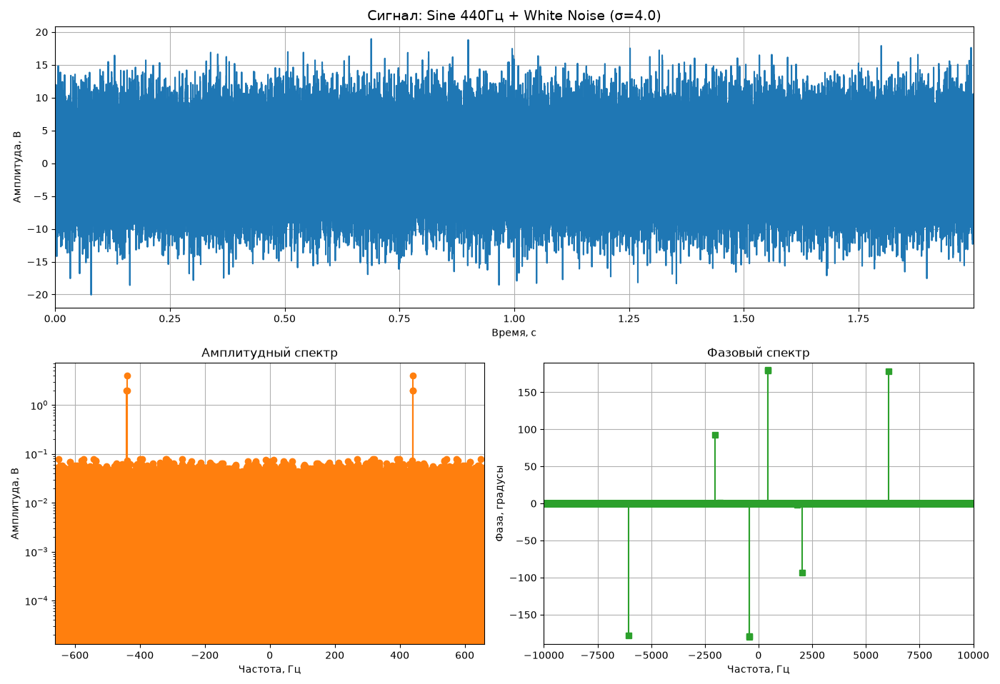
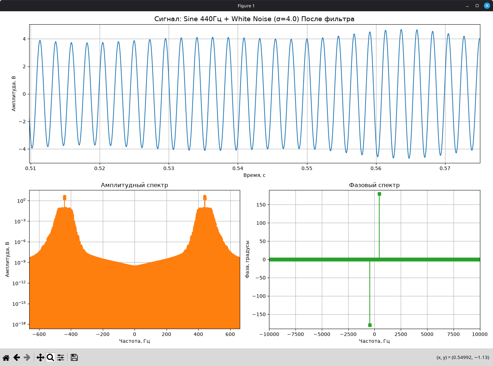
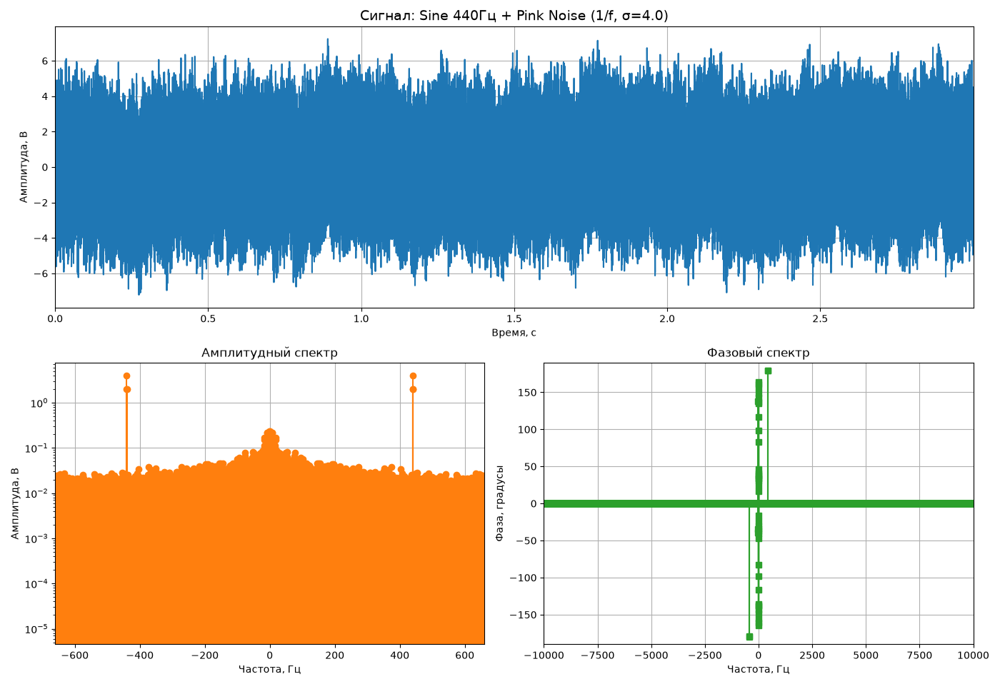
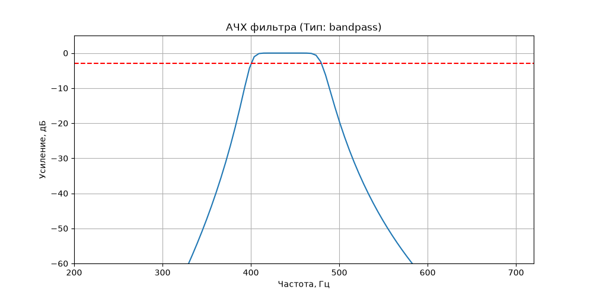
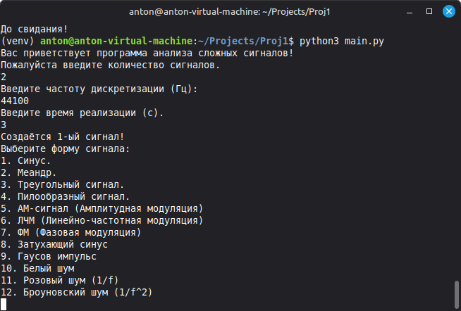

# Анализатор и фильтратор сложных сигналов (Signal Analyzer)

Консольное приложение (CLI) на Python для генерации, спектрального анализа и цифровой фильтрации сложных сигналов. 

## Возможности
- **Генерация сигналов:** 12 типов сигналов (синус, меандр, пила, АМ, ЛЧМ, ФМ, затухающий синус, импульс Гаусса), а также белый, розовый и броуновский шум.
- **Спектральный анализ:** Построение амплитудного и фазового спектров с использованием БПФ (FFT). Поддержка оконной функции Ханна для минимизации растекания.
- **Фильтрация:** Проектирование и применение БИХ-фильтров (Баттерворта, Чебышева I и II рода, Эллиптического, Бесселя). Поддержка ФНЧ, ФВЧ, полосовых и режекторных фильтров.
- **Дополнительно:** Построение спектральной плотности мощности (метод Уэлча), Эмпирическая модовая декомпозиция (EMD), экспорт результатов в WAV-аудиофайлы.

## Установка и настройка:

1. Клонируйте репозиторий:
   ```bash
   git clone https://github.com/ваш_ник/название_репозитория.git  # GitHub
   git clone https://gitflic.ru/ваш_ник/название_репозитория.git  # GitFlic
   cd название_репозитория

2. Создайте и активируйте виртуальное окружение:
    ```bash
    python -m venv venv
    source venv/bin/activate  # Для Linux
    # venv\Scripts\activate   # Для Windows

3. Установите необходимые зависимости:
    ```bash
    pip install -r requirements.txt

## Использование:
- Запустите основной файл программы:
    ```bash
    python3 main.py    # Для Linux
    # python main.py   # Для Windows

- Программа предложит вам интерактивное меню в терминале. Следуйте инструкциям:

    1. Укажите частоту дискретизации и время реализации.
    2. Выберите форму генерируемого сигнала (и добавьте шум, если нужно).
    3. Программа сама построит амплитудный и фазовый спектры.
    4. Затем можно дополнительно построить СПМ сигнала и провести ЭМД анализ.
    4. При необходимости настройте (после настройки программа предложит построить график АЧХ фильтра) и примените фильтр.
    5. После применения фильтра программа построит амплитудный и фазовый спектр отфильтрованного сигнала.
    6. При необходимости можно сохранить сигнал в аудиофайл для прослушивания.

## Примеры работы

### 1. Выделение полезного сигнала из шума
Ниже показан результат применения полосового фильтра Чебышева (400–480 Гц) к сигналу, зашумленному белым шумом с σ=4.0. Программа успешно выделила исходную синусоиду 440 Гц.



### 2. Спектральный анализ сложных сигналов
Встроенный анализатор спектра позволяет видеть частотные составляющие. На графике ниже показан спектр синуса 440 Гц, смешанного с розовым шумом (1/f).


### 3. Проектирование цифровых фильтров
Модуль фильтрации строит АЧХ для наглядной проверки параметров среза (ФНЧ, ФВЧ, полосовых).


### 4. Консольный интерфейс
Программа имеет удобное интерактивное меню с валидацией ввода и поддержкой 12 типов сигналов.


## Статус проекта:
- Проект находится в стадии активной разработки. Реализованы основные функции генерации, анализа и фильтрации. В планах — добавление КИХ-фильтров и графического интерфейса (GUI).

## Контакты:

- GitHub: @
- GitFlic: @
- Email: 


